# AWS Lab

Simulador de AWS en español para aprender Cloud y DevOps sin cuenta, sin tarjeta y sin riesgo de factura. Incluye una consola web, un CLI `aws` con una terminal Bash simulada (también como CloudShell) y una academia de 15 niveles con laboratorios que se validan automáticamente.

Todo se ejecuta en el navegador: no hay ninguna llamada a AWS ni credenciales reales.

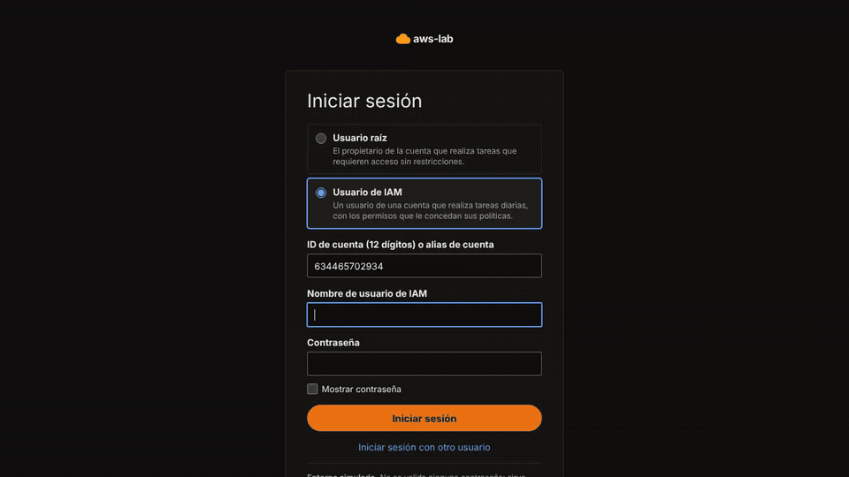

## Por qué

Preparando la certificación AWS Solutions Architect Associate (SAA-C03) quería practicar con servicios reales (IAM, VPC, EC2, S3, CloudFormation, ECS, Lambda...) sin el riesgo de olvidar un NAT Gateway encendido. Un simulador permite equivocarse, ver los errores reales de AWS (`AccessDenied`, `DependencyViolation`, `BucketNotEmpty`...) y repetir el ejercicio las veces que haga falta.

La idea de aprender con un simulador propio parte del proyecto [azure-lab](https://github.com/SalmeronDevZone/azure-lab) (ver [Créditos y aviso](#créditos-y-aviso)).

## Capturas

| | |
| --- | --- |
| 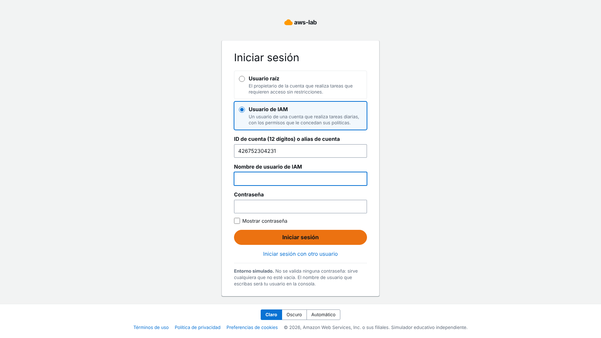 <br> Inicio de sesión | 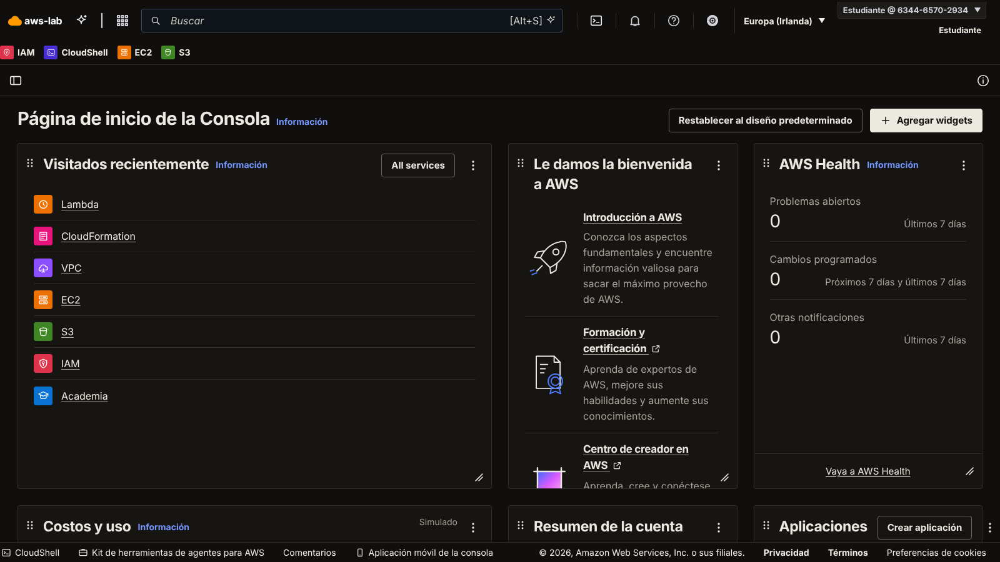 <br> Inicio de la consola (oscuro) |
| 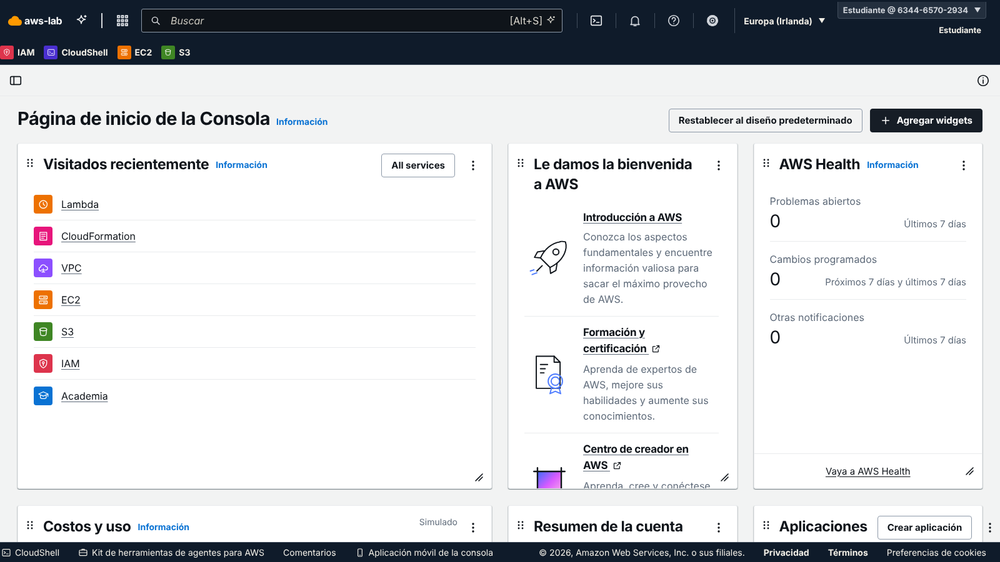 <br> Inicio de la consola (claro) | 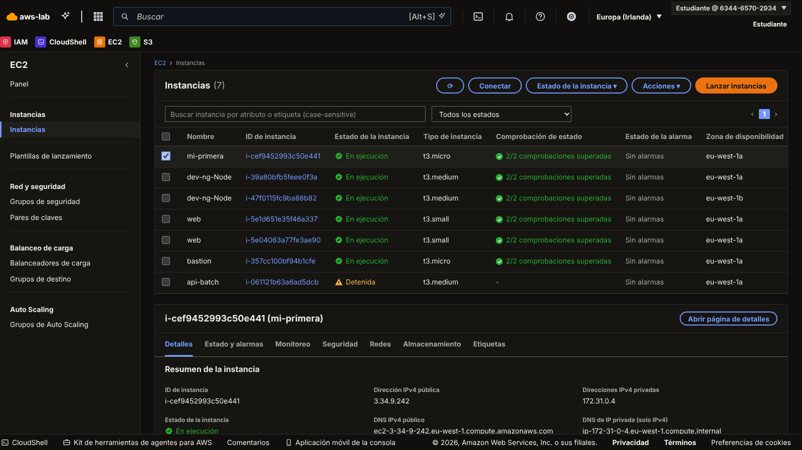 <br> EC2: instancias |
| 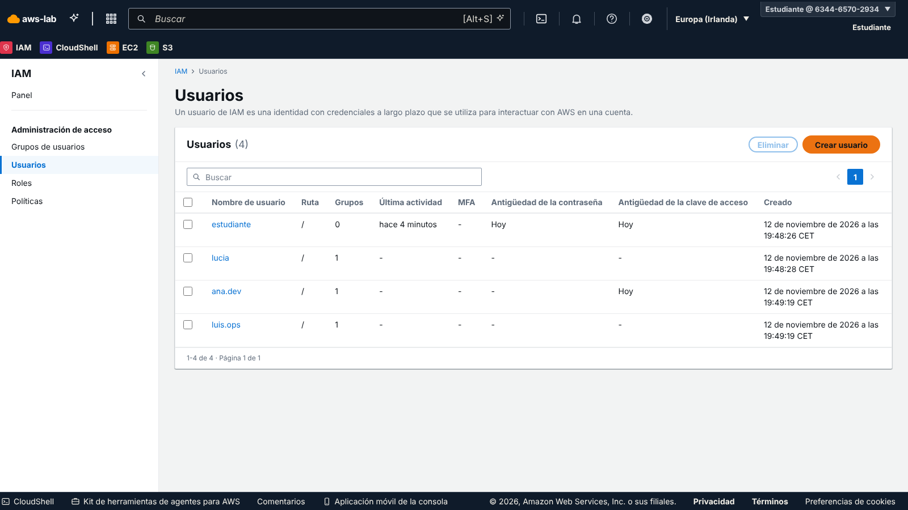 <br> IAM: usuarios | 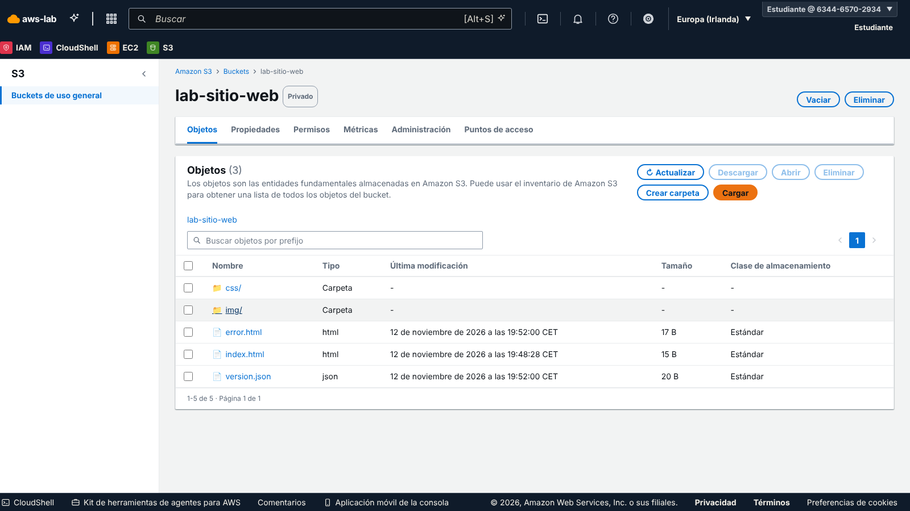 <br> S3: contenido de un bucket |
| 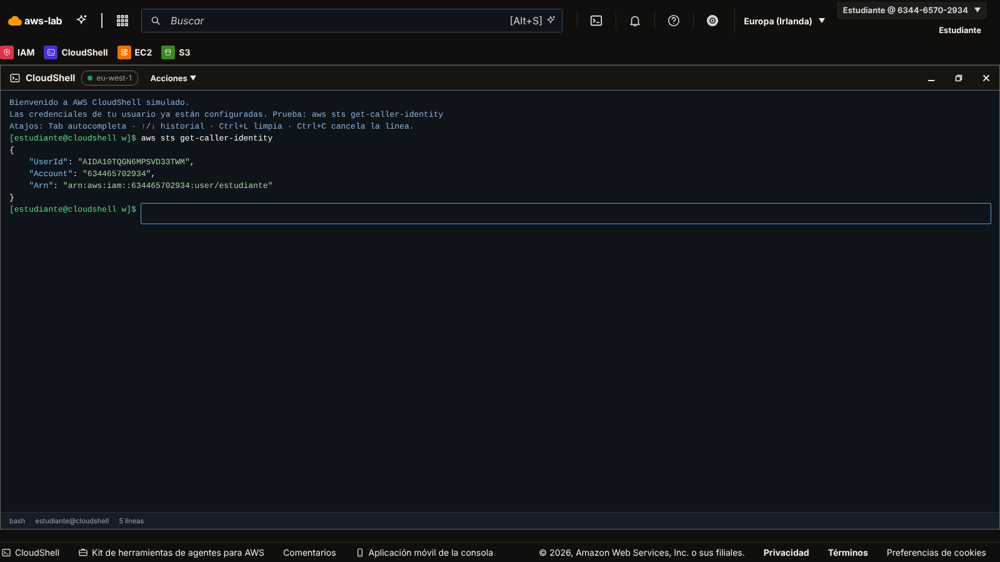 <br> CloudShell: `aws sts get-caller-identity` | 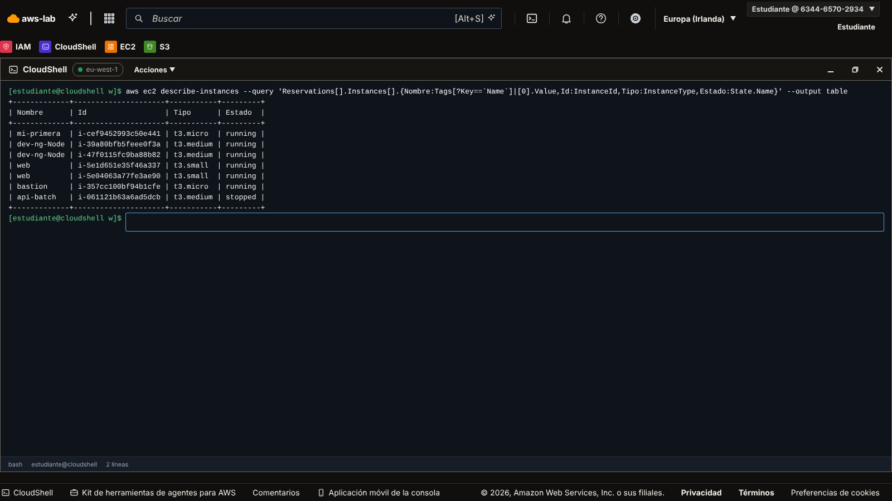 <br> CloudShell: `aws ec2 describe-instances` |
| 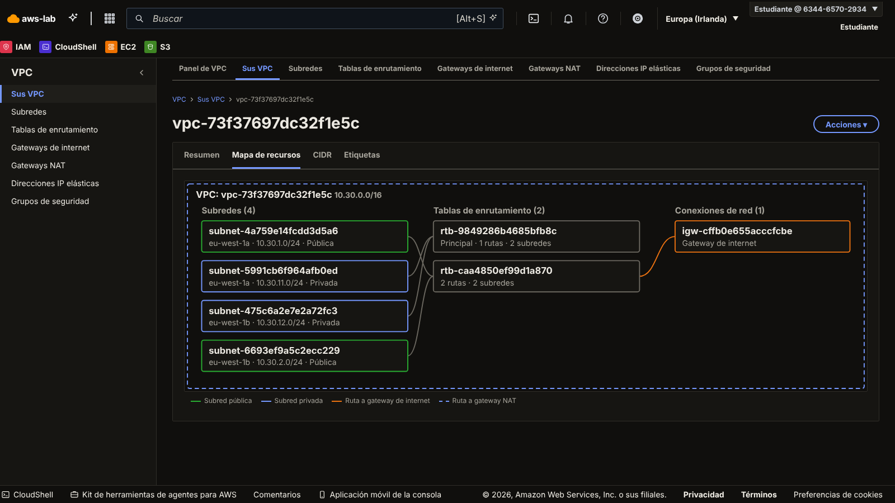 <br> VPC: mapa de recursos | 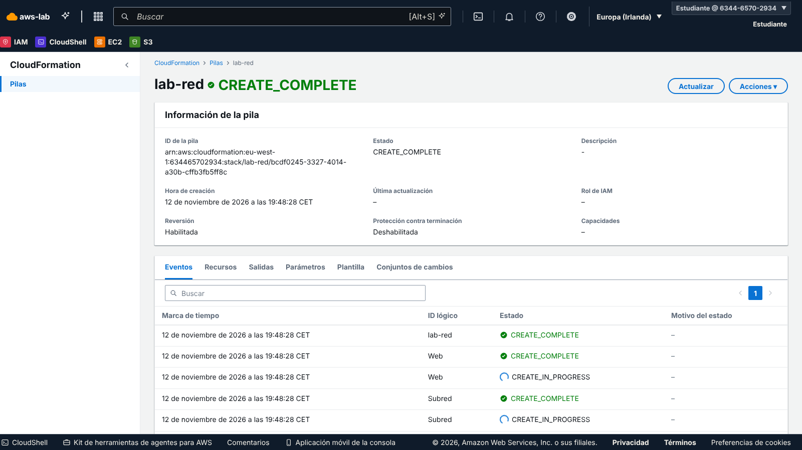 <br> CloudFormation: pila |
| 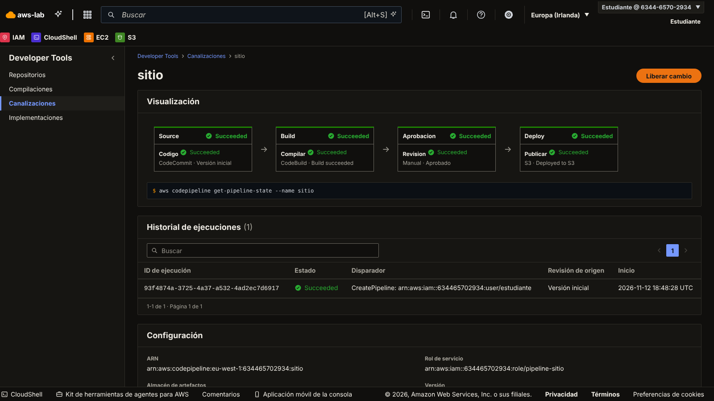 <br> CodePipeline: canalización | 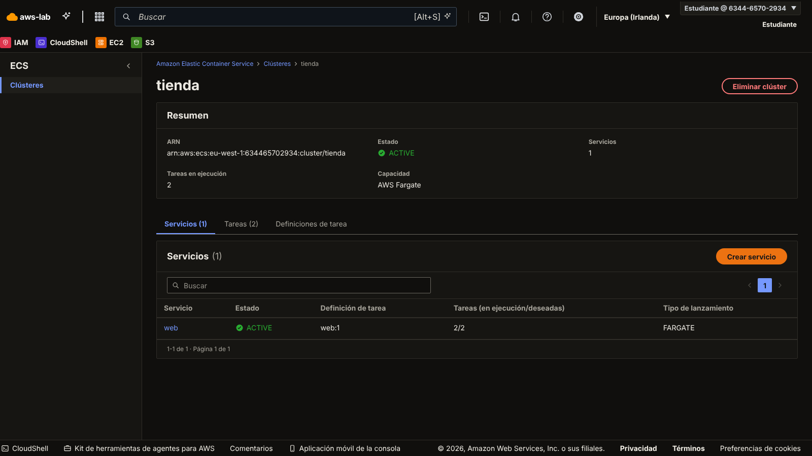 <br> ECS: clúster con servicio Fargate |
| 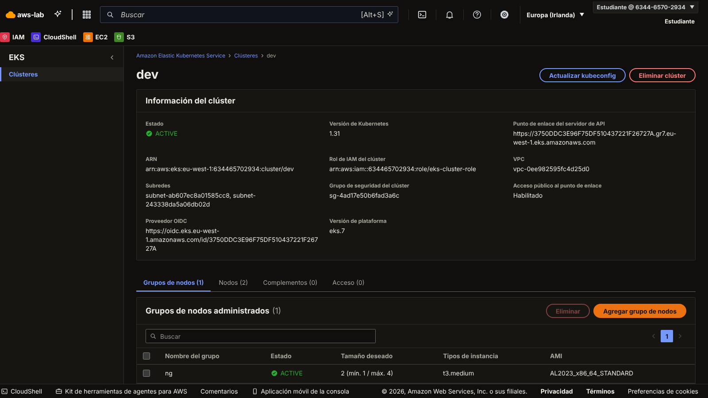 <br> EKS: clúster | 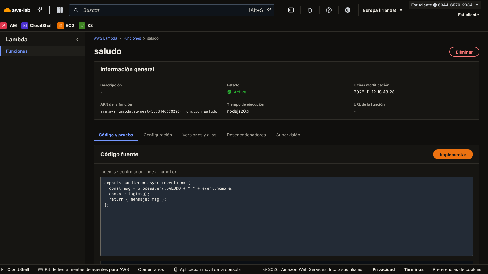 <br> Lambda: función |
| 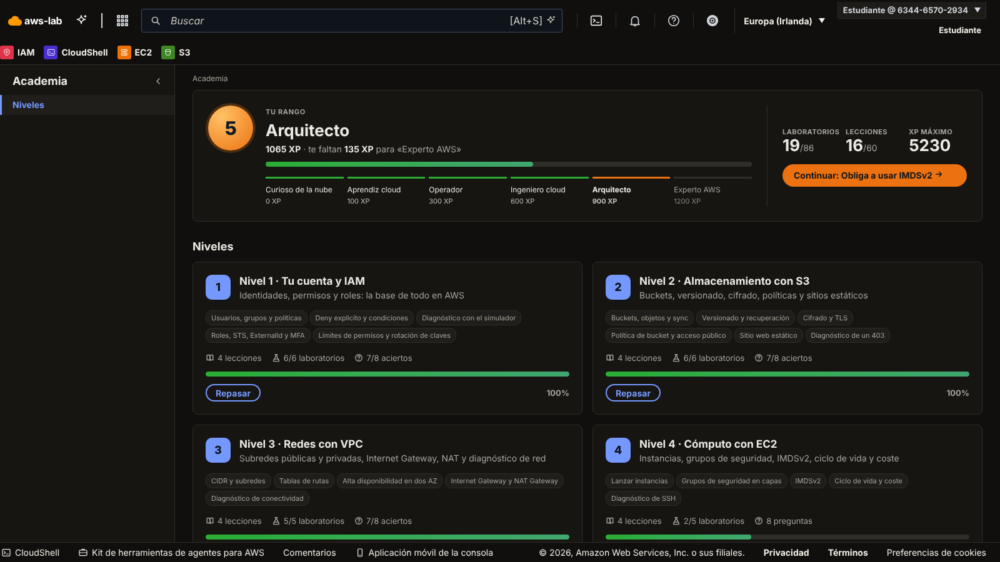 <br> Academia: niveles y rango | 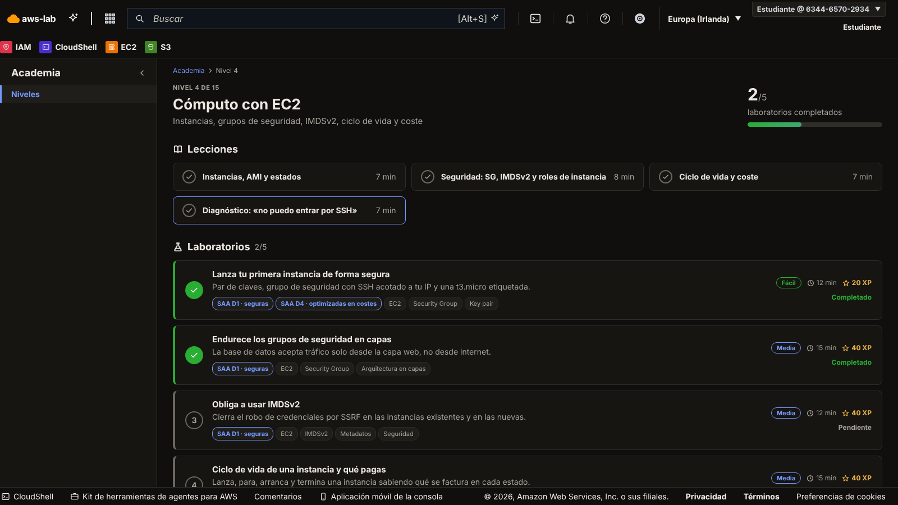 <br> Academia: un nivel |
| 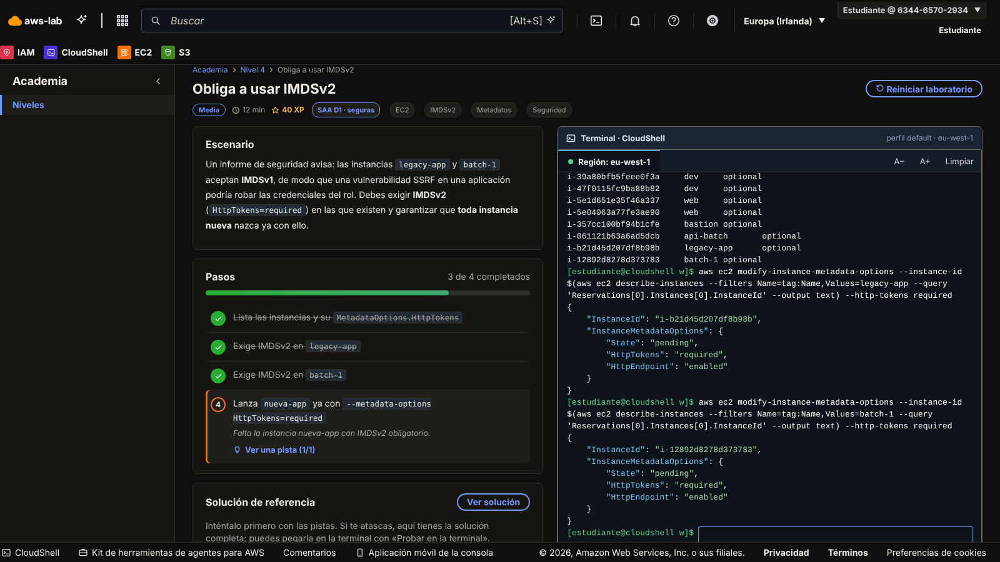 <br> Academia: laboratorio con pasos completados | |

Las capturas usan datos creados con el propio simulador; los identificadores y la cuenta son ficticios y se generan aleatoriamente.

## Qué incluye

### Consola web

Interfaz en español con tema claro, oscuro y automático, buscador de servicios, favoritos, widgets en la portada y selector de región (7 regiones). Cada acción de la consola se ejecuta como el comando equivalente del CLI, de modo que queda registrada en CloudTrail igual que en AWS.

Servicios con página propia:

| Categoría | Servicios |
| --- | --- |
| Computación | EC2 (instancias, grupos de seguridad, pares de claves, balanceadores, Auto Scaling), Lambda, ECR, ECS (Fargate), EKS |
| Almacenamiento | S3 |
| Redes | VPC (subredes, tablas de rutas, IGW, NAT, EIP, grupos de seguridad, mapa de recursos), Route 53 |
| Seguridad e identidad | IAM, KMS, Secrets Manager |
| Gestión y gobernanza | CloudFormation, CloudWatch, CloudTrail, Organizations, Config, Billing y Cost Explorer, Budgets, Trusted Advisor |
| Integración y datos | API Gateway, SQS, SNS, DynamoDB, RDS |
| Herramientas de desarrollo | CodeCommit, CodeBuild, CodePipeline, CodeDeploy |

### Terminal y CLI

Disponible en la página CloudShell y dentro de cada laboratorio:

- **Bash simulado**: tuberías, variables, `$(...)`, redirecciones, here-documents, `if`/`for`/`while`, funciones y scripts, historial y autocompletado.
- **Utilidades**: `grep`, `sed`, `awk`, `jq`, `cut`, `sort`, `uniq`, `find`, `xargs`, `curl`, `dig`, `zip`/`unzip`, `crontab`, etc.
- **CLI `aws`** con `--query` (JMESPath), `--output json|text|table|yaml`, `file://`, sintaxis abreviada, perfiles y credenciales temporales por variables de entorno. Cubre STS, IAM, EC2, S3 (alto nivel y `s3api`), CloudTrail, KMS, Secrets Manager, CloudFormation, CloudWatch y Logs, ELBv2, Auto Scaling, Route 53, SNS, SQS, Lambda, API Gateway, DynamoDB, RDS, ECR, ECS, EKS, CodeCommit/Build/Pipeline/Deploy, Organizations, Config, Budgets, Cost Explorer y Support.
- **Herramientas de DevOps**: `terraform` (init, validate, fmt, plan, apply, destroy, state...), `git` (con el asistente de credenciales de CodeCommit), `docker` (build, tag, push a ECR, run) y `kubectl` contra los clústeres de EKS simulados.

### Motor

El motor de la nube simulada no depende de la interfaz y se prueba por separado. Reproduce, entre otras cosas:

- Evaluación de políticas IAM: Deny explícito > Allow > denegación implícita, `NotAction`/`NotResource`, condiciones, variables, límites de permisos, políticas de sesión y de recurso, SCP.
- STS: `AssumeRole` (trust policy, MFA, ExternalId, duración, política de sesión) y caducidad de credenciales.
- Ciclo de vida y coste de las instancias, IMDSv2, diagnóstico de conectividad de red.
- Estados intermedios que avanzan con el tiempo (`CREATE_IN_PROGRESS`, `pending`...) con velocidad configurable.
- Errores con los textos reales de AWS y cada llamada registrada en CloudTrail.

### Academia

15 niveles, ordenados de lo básico a un proyecto final, con rangos y XP (de «Curioso de la nube» a «Experto AWS»):

| Recuento | |
| --- | --- |
| Niveles | 15 |
| Lecciones | 60 |
| Laboratorios | 86 |
| Pasos validados automáticamente | 367 |
| Preguntas de cuestionario | 124 |

| Nivel | Tema |
| --- | --- |
| 1 | Tu cuenta y IAM |
| 2 | Almacenamiento con S3 |
| 3 | Redes con VPC |
| 4 | Cómputo con EC2 |
| 5 | Cifrado y secretos (KMS, Secrets Manager) |
| 6 | Observabilidad (CloudWatch, SNS) |
| 7 | Alta disponibilidad (Route 53, ELB, Auto Scaling) |
| 8 | Infraestructura como código con Terraform |
| 9 | CloudFormation |
| 10 | Git y CI/CD (CodeCommit, CodeBuild, CodePipeline, CodeDeploy) |
| 11 | Contenedores: ECR, ECS y EKS |
| 12 | Serverless y datos (Lambda, API Gateway, SQS, DynamoDB, RDS) |
| 13 | Gobernanza y costes (Organizations, Config, Budgets, Cost Explorer, Trusted Advisor) |
| 14 | Proyecto final: arquitectura segura |
| 15 | Linux y Bash |

Cada nivel tiene 4 lecciones, laboratorios y un cuestionario. Los niveles se desbloquean según el progreso (hay un modo libre).

## Cómo funcionan los laboratorios

Cada laboratorio (`Exercise` en `src/ui/academy/types.ts`) es un escenario con pasos que el simulador comprueba solo, sin botón de «comprobar»:

- **`check`**: función de cada paso que inspecciona el estado de la nube simulada (y CloudTrail) y devuelve `true` o un texto que explica qué falta. Los pasos se completan en cuanto el estado cumple la condición, sin importar cómo se haya llegado a él (consola o CLI).
- **`script`**: solución de referencia, una orden por línea. Un test automático la ejecuta y exige que todos los pasos pasen, de modo que ningún laboratorio puede quedar imposible de resolver.
- **`saa`**: dominios del examen SAA-C03 que practica (seguridad, resiliencia, rendimiento, coste).
- **`realWorld`**: qué repetir en una cuenta real, qué puede costar y qué limpiar después.
- **`setup`** (opcional): prepara el escenario, por ejemplo recursos mal configurados que hay que diagnosticar.

Además hay pistas progresivas, solución de referencia y reinicio del laboratorio. La auditoría pedagógica de las pruebas comprueba que no haya laboratorios que arranquen ya resueltos.

## Cómo arrancar

Requisitos: Node.js 20 o superior.

```bash
npm install
npm run dev        # servidor de desarrollo de Vite (http://localhost:5173)
```

Otros comandos:

```bash
npm test           # pruebas del motor, el shell y la academia (Vitest)
npm run typecheck  # comprobación de tipos
npm run build      # compilación de producción en dist/
npm start          # sirve dist/ con el servidor mínimo (puerto 8080)
```

### Con Docker

```bash
docker compose up -d --build
# abre http://localhost:8080
```

`docker-compose.yml` construye la imagen, expone el puerto 8080 y guarda el estado en el volumen `aws-lab-data`, de modo que la nube y el progreso sobreviven a reinicios. Sin Docker, el estado se guarda en el `localStorage` del navegador.

### Saltar el inicio de sesión

La pantalla de login es solo de interfaz (vale cualquier contraseña no vacía). Para pruebas automáticas se puede omitir con `?nologin` en la URL o `localStorage['awslab.nologin'] = '1'`.

## Estructura del proyecto

```
src/
  engine/            Motor de la nube simulada (sin dependencias de interfaz)
    services/        IAM, S3, EC2, CloudFormation, ECS, EKS, KMS, CodePipeline...
    serverless/      Lambda (intérprete de JS), API Gateway, SQS, DynamoDB, RDS
  shell/             Bash simulado, CLI aws, terraform, git, docker, kubectl
    aws/commands/    Un fichero por servicio del CLI
  ui/                Consola web en React
    pages/           Una carpeta o fichero por servicio, Login, Home, CloudShell, Academia
    academy/         Currículo (content/l01..l15), progreso y comprobaciones
tests/               Pruebas Vitest del motor, shell, academia y servicios
tests/e2e/           Recorridos con Playwright (laboratorios y consola)
server/              Servidor mínimo para Docker (sirve dist/ y guarda el estado)
```

Pila: React 18, TypeScript, Vite 5 y Vitest. Pruebas: 19 ficheros, 367 tests.

## Limitaciones conocidas

- **Es una simulación, no AWS.** Cubre una parte de cada servicio (la que se necesita para aprender y para el SAA), no todas sus opciones ni todas sus API. Habrá comandos o parámetros que existen en AWS y aquí no.
- **Sin tráfico real.** Las instancias no ejecutan sistemas operativos, los contenedores y los pods son modelos, y las comprobaciones de red se resuelven con las reglas simuladas de VPC, grupos de seguridad y NACL.
- **Lambda** solo ejecuta runtimes Node.js (`nodejs18.x`, `20.x`, `22.x`) con un intérprete de JavaScript propio que admite lo habitual de un handler, pero no cualquier paquete de npm. Otros runtimes se rechazan con un error explícito.
- **Terraform y CloudFormation** soportan un subconjunto de recursos y funciones; las plantillas muy avanzadas pueden no funcionar.
- **Costes y cuotas.** Los costes son estimaciones didácticas, no precios oficiales. Los límites de cuota, la consistencia eventual y muchos tiempos reales no se reproducen.
- **Idioma.** La interfaz y los contenidos están en español; algunos textos técnicos y nombres de API se mantienen en inglés, como en AWS.
- **Un solo usuario y un navegador.** El estado vive en el `localStorage` (o en el volumen de Docker); no hay cuentas ni sincronización entre dispositivos.
- **Repasa lo aprendido en una cuenta real.** Cada laboratorio incluye un apartado «Repítelo en tu cuenta real» con avisos de coste y limpieza, porque los comportamientos finos (cuotas, retrasos, precios) solo se ven allí.

## Créditos y aviso

Proyecto personal de aprendizaje, de su autor. Está inspirado en la idea de [azure-lab](https://github.com/SalmeronDevZone/azure-lab) (SalmeronDevZone), un simulador equivalente para Azure, sin reutilizar su código: la implementación es propia.

Es un proyecto independiente, sin ninguna afiliación con Amazon Web Services ni con Microsoft. «AWS», «Amazon Web Services» y los nombres de sus servicios, así como sus marcas, pertenecen a sus respectivos propietarios y se mencionan solo para describir qué se simula. El proyecto no usa los logotipos oficiales: la marca «aws-lab» (nube naranja y texto) es de diseño propio.
